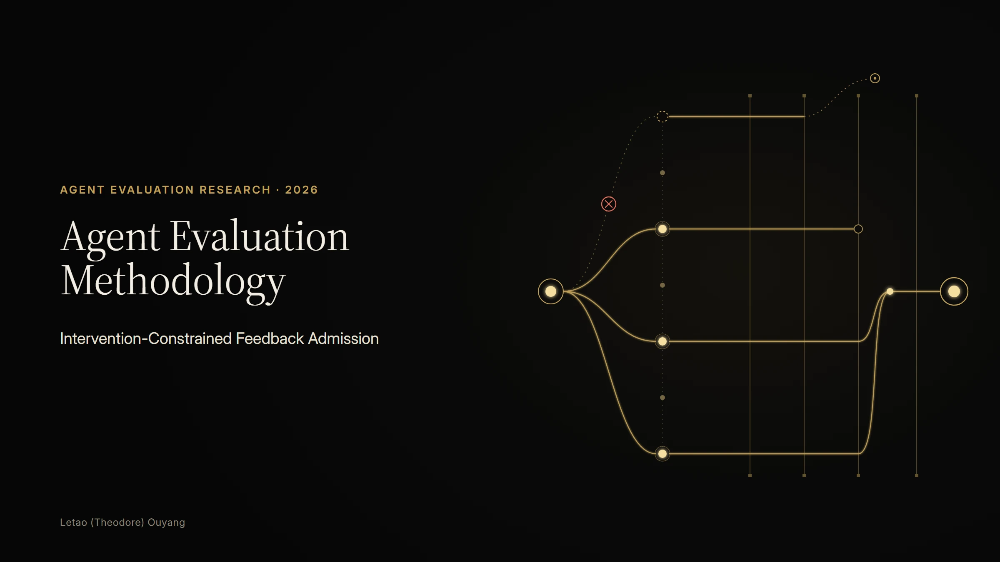
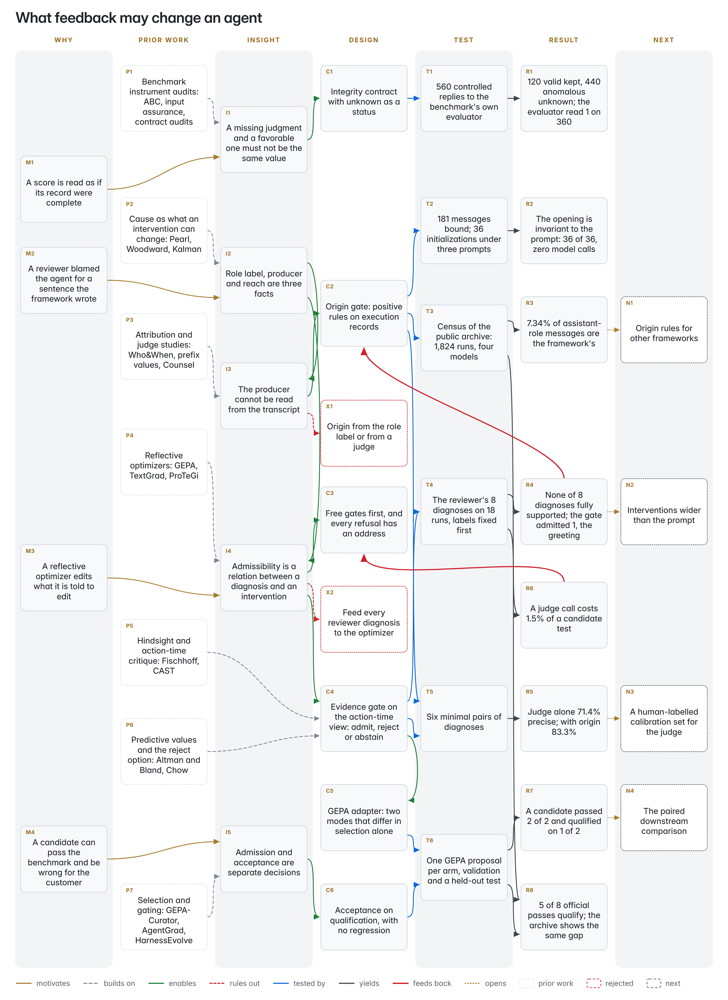

<p align="center"></p>

# Agent Evaluation Methodology: Intervention-Constrained Feedback Admission

**Letao (Theodore) Ouyang** · Independent research · May – September 2026

[Article](manuscript/intervention-constrained-feedback-admission.md) · [PDF](paper/paper.pdf) · [Results](reproduce/results.md) · [Derivations](docs/derivations.md) · [Design notes](docs/design-notes.md) · [Research route](docs/research-route.md) · [Literature](docs/literature.md)

**What must be true of a diagnosis before it is allowed to change an agent?**

A reflective optimizer reads a failed trace, a reviewer explains the failure, and the explanation becomes the next
prompt. The loop assumes that the thing criticized is the thing being changed. I found the assumption failing in a
widely used benchmark. In τ²-bench retail the first assistant message of every conversation is written by the
framework before the model is called; a reviewer faulted the agent for it, and a judge told to check the evidence
accepted the fault with the words "the actor controlled that response". No edit to the prompt can change that
message. I built Intervention-Constrained Feedback Admission (ICFA) to repair the loop: four gates between
evaluation feedback and GEPA's prompt optimizer, each removing a different way of being wrong and each with its
own exit. Admissibility is a relation between a diagnosis and an intervention, so a diagnosis the prompt cannot
act on is routed to whoever can.

## Three results to start with

| Result | Why it matters | Where |
| --- | --- | --- |
| In the **1,824** published runs of τ²-bench retail, **7.34%** of the messages labelled `assistant` were written by the framework: one sentence, 1,824 times, under four different agent models. In **98.7%** of the runs the model's first action of its own is the authentication step that the sentence is faulted for omitting | The producer of a message cannot be read from the transcript. Two runs with one transcript and two producers force any transcript-only gate, however capable, to err on one of them | [§2, §3](manuscript/intervention-constrained-feedback-admission.md) · [D2](docs/derivations.md#d2-the-producer-is-not-identifiable-from-the-transcript) |
| Of the **8** diagnoses the benchmark's reviewer produced, **none** was fully supported. On six minimal pairs a judge admitted every supported diagnosis and no refuted one, and **71.4%** of what it admitted was supported; with the origin gate, **83.3%**, at zero model calls | Origin removes a class of invalid feedback that a judge is blind to, and takes no valid feedback with it | [§5, §6](manuscript/intervention-constrained-feedback-admission.md) · [D5](docs/derivations.md#d5-classes-of-invalid-feedback-and-gates-in-series) |
| A candidate that GEPA wrote passed **2 of 2** validation tasks on the official score and qualified on **1**: it promised a refund deadline the policy does not give. In the public archive, **9 of 10** runs in which the agent supplied outside knowledge that the policy rules out received the full reward | Admission and acceptance are separate decisions, and the score is not the acceptance criterion | [§7](manuscript/intervention-constrained-feedback-admission.md) · [D9](docs/derivations.md#d9-what-the-acceptance-rule-guarantees) |

All 187 figures in the article are recomputed in [results](reproduce/results.md).

## The problem

Reflective optimizers turn language into the gradient: a failure is explained in words, and the words become the
edit. The explanation is therefore the object on which everything depends, and it is weaker than the loop assumes.
On the Who&When dataset the best automated method names the decisive step in 14.2% of failures. When agents are
restarted from the steps that frontier judges label as the first mistake, the probability of success does not drop
at the labelled step in 66% of cases.

Those studies ask whether a diagnosis is true. There is a question before that one. The retail policy says the
agent must authenticate the user at the beginning of the conversation, and every trace begins

> **assistant:** Hi! How can I help you today?

A reviewer wrote that the agent "first asked how it could help rather than initiating authentication". The claim
is right on the policy. It is addressed to the wrong component: the orchestrator inserts that sentence before the
first model call, and the agent's first generated message, at turn 2, asks the customer to authenticate.

## The idea

**Three facts about a message.** The role label it carries, the component that produced it, and the component the
current optimization step may edit. The third is defined on the system's causal graph: for an intervention on a
set of components $`ℐ`$,

```math
m \in \mathrm{Reach}(ℐ) \iff \text{there is a directed path from some } c \in ℐ \text{ to } m ,
\qquad m \notin \mathrm{Reach}(ℐ) \;\Rightarrow\; m(\theta) = m(\theta') .
```

Outside the reach an edit has zero effect, and the claim is testable by changing the prompt and comparing the
message.

**Admissibility is relative to the intervention.** A diagnosis $`d`$ about a behavior $`b(d)`$ is admissible when
the evaluation record is complete, the behavior is within reach, and the claim is supported by what the agent
could see when it acted:

```math
A(d, ℐ) \;=\; C(d) \;\wedge\; b(d) \in \mathrm{Reach}(ℐ) \;\wedge\; S(d) .
```

Each term is true, false or unknown, and unknown stays unknown. A diagnosis the prompt cannot reach is delivered
to the smallest intervention that can.

**Four gates, each with an exit.**

| Gate | Question | Evidence | Cost | Exit |
| --- | --- | --- | --- | --- |
| 1 Integrity | Is the evaluation record complete and bound to this request? | The parsed reply against a five-clause contract | No model call | Unknown evaluation |
| 2 Origin | Was the criticized message produced by a component this step can edit? | The run's call ledger and the framework's source | No model call | Routed to the producer's owner |
| 3 Evidence | Is the claim supported at the moment of action? | Policy, tools, the messages before the action, the action | One judge call | Rejected, or abstained |
| 4 Acceptance | Does the changed strategy deserve to stay? | Reward, record, soundness, user validity, critical violations | The candidate's runs | Keep the seed |

**What a gate does to precision.** With $`p`$ the share of valid diagnoses offered, $`t`$ the share of valid ones
admitted and $`f`$ the share of invalid ones admitted,

```math
\Pr[\text{valid} \mid \text{admitted}] = \frac{p\,t}{p\,t + (1-p)\,f} ,
```

which rises exactly when $`t > f`$. Rejecting more proves nothing. A gate earns its place by telling valid
feedback from invalid, and a gate that is blind to one kind of invalid feedback contributes nothing against it.

## Results

**Origin, on public data.** The benchmark's authors publish result files for four agent models on 114 retail tasks
with four trials each. Every assistant-role message was classified from its generation record.

| | Runs | Assistant-role messages | Framework | Model | Unknown |
| --- | ---: | ---: | ---: | ---: | ---: |
| Four models, 114 tasks, four trials | 1,824 | 24,836 | 1,824 | 23,012 | 0 |

In my own 18 runs all 181 assistant-role messages were bound, 18 to the framework and 163 to the model, and the
opening stayed identical under three different system prompts on 12 tasks: 36 of 36, with zero model calls.

**Integrity.** On 560 controlled replies fed to the benchmark's own assertion evaluator, the contract kept all 120
valid records and held all 440 anomalous ones as unknown. The evaluator's component read 1 on 360 of the 440; on
an empty reply it reads 1 because a conjunction over no results is true.

**The reviewer's diagnoses as they occurred.**

| Reference label, fixed before the gate ran | Diagnoses | Rejected | Abstained | Admitted |
| --- | ---: | ---: | ---: | ---: |
| Supported on all three questions | 0 | 0 | 0 | 0 |
| Insufficient | 6 | 3 | 2 | 1 |
| Unsupported | 2 | 2 | 0 | 0 |

The one admitted diagnosis is the greeting. It is right on the policy and wrong on the producer, and the origin
gate routes it to framework review.

**Six minimal pairs.**

| Reference tier | Cards | Judge admits | Admitted after origin |
| --- | ---: | ---: | ---: |
| Supported | 5 | 5 | 5 |
| Unsupported | 3 | 0 | 0 |
| Insufficient | 4 | 2 | 1 |

One pair has the same sentence and the same claim, with the framework as producer in one card and the model in
the other. The judge admitted both, and the ledger separated them.

**A candidate the benchmark passed.** GEPA's candidate matched the seed on the official score, 2 of 2, and closed
one validation run with "The PayPal refunds should be processed within 5–7 business days", a deadline the policy
gives for cancellations and not for the return it had just filed. It qualified on 1 of 2, and the acceptance rule
kept the seed. In the held-out test 8 runs passed on the official reward and 5 qualified.

**Cost.** Integrity and origin cost no model call. The evidence gate costs 16,256 input tokens per diagnosis,
1.5% of the 1,076,788 it took to test one candidate.

## What is new

Reflective optimization, failure attribution, candidate gating and action-time critique are established lines of
work. What I built:

1. **The separation of label, producer and reach**, with a proof that the producer is not identifiable from the
   transcript and a matched pair of diagnoses that shows it. Failure attribution and LLM judges take the
   transcript as their only input; the proof says what no transcript can settle.
2. **Admissibility as a relation between a diagnosis and an intervention.** Reach is a necessary condition for an
   edit to have any effect, and a refused diagnosis is routed to the smallest intervention that contains its
   target. Credit-assignment methods choose the prompt to edit by intervening or by contrasting rollouts, with a
   rerun as the evidence. Here the decision is made for one diagnosis, from execution records, before any rerun.
3. **A census of message origin on a public benchmark archive**, with the rules, the verified files and the
   script. Benchmark audits examine graders, renderers and logs; this one counts who wrote each message.
4. **The decomposition of a gate's false admissions by class**, which shows that a judge and an origin check are
   blind to complementary kinds of invalid feedback, so neither replaces the other.
5. **An integrity contract in which each clause removes what the earlier ones accept**, tested on the
   benchmark's own evaluator: a contract at the narrowest point, one judge reply and one score.
6. **An acceptance rule with the terms a score leaves out**: soundness against the policy, the validity of the
   simulated user, and no regression. Candidate gates act on task success after the edit is written; admission
   acts before it, and acceptance adds what the score does not show.

[Where this work sits](docs/literature.md) sets each of these against the closest prior work, and the
[bibliography](docs/bibliography.md) lists all 111 sources.

## How the argument was built

<picture>
  <source media="(prefers-color-scheme: dark)" srcset="assets/route-dark.png">
  
</picture>

The route is a network. The four gates were worked out against each other, and two results went back and changed
the design.

- **Whose behavior was it.** The evidence gate was built first, and the single diagnosis it admitted was about the
  framework's greeting. That result made origin a gate.
- **Which gate runs first.** The measured cost of a judge call put the gates that cost nothing in front of it.
- **What a score leaves out.** A candidate that tied on the official score while promising what the policy does
  not, and an archive in which such runs score in full, are the case for the terms of acceptance.

The [research route](docs/research-route.md) explains all 42 steps and all 44 links.

## If you optimize an agent from its failures

| If you | The article shows | Do this |
| --- | --- | --- |
| Feed a reviewer's diagnoses to a prompt optimizer | None of eight natural diagnoses was fully supported | Admit diagnoses one by one, on the action-time view, with abstention |
| Attribute by role label | 7.34% of assistant-role messages in the archive are the framework's | Keep a call ledger and bind each message to its producer before blaming the prompt |
| Rely on a judge to catch misattribution | The judge admitted the same wrong claim twice | Decide origin from records; a judge cannot see it |
| Accept a candidate on the benchmark score | A passing candidate promised what the policy does not | Qualify runs on soundness and user validity, and require no regression |
| Trust a score that parsed | 360 of 440 anomalous replies read as 1 | Check count, identity, type and binding, and treat anything short as unknown |

## Repository

| Path | Contents |
| --- | --- |
| [`manuscript/`](manuscript/intervention-constrained-feedback-admission.md) | The article |
| [`paper/paper.pdf`](paper/paper.pdf) | The article as a PDF |
| [`docs/derivations.md`](docs/derivations.md) | Every proof in full, D1 to D9 |
| [`docs/design-notes.md`](docs/design-notes.md) | Each design choice, the alternative it beat, and how the experiments were set up |
| [`docs/research-route.md`](docs/research-route.md) | The logic of the work as a network, node by node |
| [`docs/literature.md`](docs/literature.md) · [`docs/bibliography.md`](docs/bibliography.md) | Where the work sits, and the 111 sources |
| [`src/icfa/`](src/icfa) · [`tests/`](tests) | The four gates, the arithmetic of admission and the GEPA adapter, with 137 tests |
| [`evidence/`](evidence/README.md) | The measurements: the archive census, the integrity experiment, the origin audit, the diagnoses, the cards, the pilot and its dialogues |
| [`reproduce/`](reproduce/README.md) | Code that recomputes every figure in the article, and the [results](reproduce/results.md) |

## Materials

τ²-bench at revision `2174a60` supplies the task environment and its evaluator, and GEPA at revision `15ee314`
supplies reflective prompt optimization; their licenses are in [THIRD_PARTY_NOTICES](THIRD_PARTY_NOTICES.md). The
agent, the simulated user, the reviewer and the judges ran on gpt-5.6-sol at low reasoning effort. Reference
labels were assigned by independent model reviewers and fixed before each gate ran.

## Citation

Letao (Theodore) Ouyang, *Agent Evaluation Methodology: Intervention-Constrained Feedback Admission* (2026),
<https://github.com/130U/RESEARCH-Agent-Evaluation-Methodology/blob/main/paper/paper.pdf>. See
[CITATION.cff](CITATION.cff).

[theodore.oy2025@gmail.com](mailto:theodore.oy2025@gmail.com) · [10@alumni.duke.edu](mailto:10@alumni.duke.edu)

© Letao (Theodore) Ouyang. All rights reserved.
