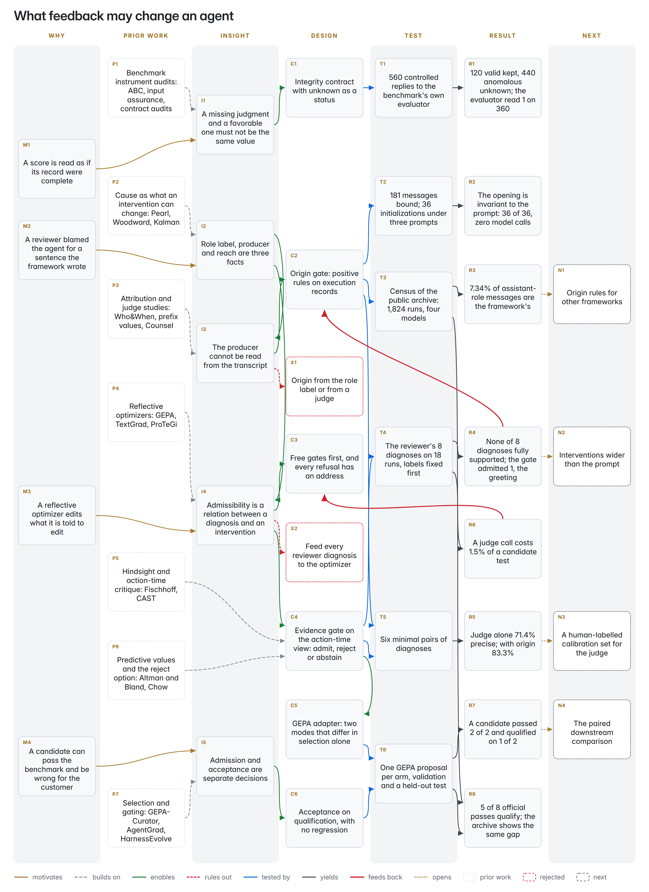

# Research route

How the argument was built: which observation forced which design choice, where a result went back and changed the
design, and what each result opens. The work did not run from problem to solution in one line. The four gates
were worked out against each other, because each removes a way of being wrong that the others cannot see.

<picture>
  <source media="(prefers-color-scheme: dark)" srcset="../assets/route-dark.png">
  
</picture>

## Reading the figure

Columns are kinds of step, not stages in time. A link can run between any two columns, and two run backwards,
from a result to the design.

| Link | Meaning |
| --- | --- |
| motivates | A need or an insight that made the next step necessary |
| builds on | A published result the step starts from |
| enables | A step that makes another one possible |
| tested by / yields | A design and the test that checks it; a test and what it produced |
| feeds back | A result that changed the design |
| rules out | A finding that excludes an alternative |
| opens | A design or result that sets up the next experiment |

Solid boxes are my own steps. Dotted boxes are prior work, red dashed boxes are alternatives I rejected, and grey
dashed boxes are the experiments that come next. Design boxes are numbered C1 to C6 so that they are not confused
with the derivations D1 to D9.

## The four threads

### 1. Is the score there at all?

M1 → I1 → C1 → T1 → R1.

A judge's reply is parsed and aggregated into a score, and the score is used whether or not every expected
judgment is in the reply (M1). Audits of benchmarks have found graders that pass empty output and renderers that
drop what the judge should have read (P1). The observation underneath is that a conjunction over no results is
true, so a missing judgment and a favorable one are the same value unless something checks first (I1). I wrote
that check as a contract with five clauses and a status of unknown (C1,
[D8](derivations.md#d8-what-each-clause-of-the-integrity-contract-removes)) and fed the benchmark's own
evaluator 560 controlled replies (T1). The contract kept all 120 valid records and held all 440 anomalous ones
as unknown, while the evaluator's component read 1 on 360 of them (R1). A complete record is also the second
term of qualification in the fourth thread.

### 2. Whose behavior was it?

M2 → I2 → I3 → C2 → T2, T3 → R2, R3, with I3 ruling out X1 and R4 feeding back into C2.

A reviewer faulted the agent for the conversation's opening sentence, which the orchestrator writes (M2). The
role label on a message, the component that produced it and the component the current step may edit are three
facts (I2), and the second is defined on the system's causal graph, in the sense in which an intervention defines
a cause (P2, [D1](derivations.md#d1-reach-and-zero-effect-outside-it)). The producer cannot be read from the
transcript (I3, [D2](derivations.md#d2-the-producer-is-not-identifiable-from-the-transcript)): two runs with one
transcript and two producers defeat any gate that reads the text, however capable, which is consistent with what
judge studies report about first-mistake labels (P3). That rules out deciding origin from the label or from a
judge (X1) and leaves execution records (C2).

Two tests. In my own runs all 181 assistant-role messages were bound, 18 to the framework and 163 to the model,
and the opening stayed identical under three system prompts on 12 tasks, with zero model calls (T2, R2). In the
public archive the same rules decided all 24,836 assistant-role messages of 1,824 runs: 7.34% are the
framework's, one sentence each time (T3, R3).

The gate exists because of a result. The evidence gate was built first, and the single diagnosis it admitted was
the one about the framework's greeting (R4 → C2).

### 3. May this feedback guide this edit?

M3 → I4 → C3, C4 → T4, T5 → R4, R5, R6, with I4 ruling out X2 and R6 feeding back into C3.

A reflective optimizer edits what it is told to edit (M3, P4). I defined admissibility as a relation between a
diagnosis and an intervention (I4): the record is complete, the behavior is within the intervention's reach, and
the claim is supported by what the agent could see. Feeding every reviewer diagnosis to the optimizer fails that
definition (X2). The third term is the evidence gate (C4): a judge shown the action-time view, with the reference
answer and later messages withheld because hindsight changes what looks foreseeable (P5), deciding among admit,
reject and abstain (P6). A refused diagnosis is routed to the smallest intervention that reaches its target (C3,
[D7](derivations.md#d7-admissibility-is-monotone-and-every-refusal-has-an-address)).

On the reviewer's output as it occurred, none of eight diagnoses was supported on all three questions, and the
gate kept seven out (T4, R4). On six minimal pairs the judge admitted every supported diagnosis and no refuted
one, and 71.4% of what it admitted was supported; with origin, 83.3% (T5, R5,
[D4](derivations.md#d4-what-a-gate-does-to-precision)). The audit's ledger prices a judge call at 1.5% of a
candidate test (R6), and that measurement fixed the order: gates that cost nothing run before the judge (R6 → C3,
[D6](derivations.md#d6-when-a-gate-pays-and-the-order-of-gates)).

### 4. Is the edit worth keeping?

M4 → I5 → C6, and C5, C6 → T6 → R7, R8.

A candidate can pass the benchmark and be wrong for the customer (M4). Candidate gates exist in the literature
and act after the edit is written (P7); what they score is task success. Admission and acceptance are separate
decisions (I5), so acceptance has its own rule: a run qualifies on reward, record, soundness, user validity and
the absence of a critical violation, and a candidate must qualify on more tasks and regress on none (C6,
[D9](derivations.md#d9-what-the-acceptance-rule-guarantees)). The adapter connects the gates to GEPA with two
modes that differ in selection alone (C5).

With one proposal per arm (T6), a candidate matched the seed on the official score and qualified on one
validation task of two, having promised a refund deadline the policy gives for cancellations and not for returns
(R7). In the held-out test 5 of 8 official passes qualified, and the public archive shows the same gap on the same
task (R8, with T3).

## From results to the next experiments

| Next | Comes from | What it settles |
| --- | --- | --- |
| N1 Origin rules for other frameworks | R3 | How much of a transcript other orchestrators write, and for whom |
| N2 Interventions wider than the prompt | R4 | Whether routed diagnoses improve the framework they are delivered to |
| N3 A human-labelled calibration set for the judge | R5 | The judge's two rates on natural diagnoses, including supported ones |
| N4 The paired downstream comparison | R7 | What admission does to the optimizer's score and cost, on shared parent runs |

## Every node

| Node | Column | What it is |
| --- | --- | --- |
| **M1** A score is read as if its record were complete | Why | A judge's reply is parsed and aggregated into a score, and the score is used whether or not every expected judgment is in the reply. |
| **M2** A reviewer blamed the agent for a sentence the framework wrote | Why | In τ²-bench retail the first assistant message is inserted by the orchestrator. A reviewer faulted the agent for it and proposed a prompt fix. |
| **M3** A reflective optimizer edits what it is told to edit | Why | The diagnosis of a failed trace becomes the next prompt, so the loop assumes that the thing criticized is the thing being changed. |
| **M4** A candidate can pass the benchmark and be wrong for the customer | Why | The reward checks the database and a list of required statements. It does not check everything the agent says. |
| **P1** Benchmark instrument audits: ABC, input assurance, contract audits | Prior Work | Zhu et al. (2025), Xia et al. (2026), Bellibatlu et al. (2026): graders, renderers and tools fail silently and move scores. |
| **P2** Cause as what an intervention can change: Pearl, Woodward, Kalman | Prior Work | Interventionist causation and controllability: a component causes what manipulating it can change, and a system can steer only the states its inputs reach. |
| **P3** Attribution and judge studies: Who&When, prefix values, Counsel | Prior Work | S. Zhang et al. (2025), Shen et al. (2026), Pisupati et al. (2026): automated attribution is weak and a judge's first-mistake label often does not mark a cause. |
| **P4** Reflective optimizers: GEPA, TextGrad, ProTeGi | Prior Work | Agrawal et al. (2025) and its predecessors: natural-language diagnoses of failed traces are an efficient learning signal, taken as given. |
| **P5** Hindsight and action-time critique: Fischhoff, CAST | Prior Work | Knowledge of an outcome changes what looks foreseeable; Saeidi et al. (2026) build critiques under partial observability. |
| **P6** Predictive values and the reject option: Altman and Bland, Chow | Prior Work | The share of true positives among positives depends on prevalence; a classifier may decline to decide. |
| **P7** Selection and gating: GEPA-Curator, AgentGrad, HarnessEvolve | Prior Work | Yu et al., Chu et al., Jiang et al. (2026): curate tasks, verify by intervention which prompt to edit, gate candidates on regression. |
| **I1** A missing judgment and a favorable one must not be the same value | Insight | A conjunction over no results is true, so an empty reply reads as a pass unless the record's completeness is checked first. |
| **I2** Role label, producer and reach are three facts | Insight | What the transcript shows, which component emitted the message, and which component the current step may edit are different properties (Equations 2.1 and 2.2). |
| **I3** The producer cannot be read from the transcript | Insight | Two runs with one transcript and different producers force any transcript-only gate to err on one of them (Equation 2.3). |
| **I4** Admissibility is a relation between a diagnosis and an intervention | Insight | A diagnosis is admissible for an intervention when the record is complete, the behavior is in the intervention's reach and the claim is supported at action time (Equation 2.4). |
| **I5** Admission and acceptance are separate decisions | Insight | Whether feedback may guide an edit and whether the edit is kept need different evidence. |
| **C1** Integrity contract with unknown as a status | Design | Strict parsing, count, identity, type and binding to the request; anything short of complete is unknown (Equation 4.1). |
| **C2** Origin gate: positive rules on execution records | Design | A message is the model's when it matches exactly one agent call in the ledger, the framework's when the source and the first call establish it, and unknown otherwise. |
| **X1** Origin from the role label or from a judge | Design | Rejected: the judge wrote that the actor controlled a sentence the orchestrator inserted. |
| **C3** Free gates first, and every refusal has an address | Design | Gates ordered by cost per unit of refusal; a refused diagnosis goes to the smallest intervention that reaches the behavior. |
| **X2** Feed every reviewer diagnosis to the optimizer | Design | Rejected: none of the reviewer's eight diagnoses was supported on all three questions. |
| **C4** Evidence gate on the action-time view: admit, reject or abstain | Design | A judge sees the policy, the tools, the messages before the action and the action, and passes an admitted diagnosis on verbatim. |
| **C5** GEPA adapter: two modes that differ in selection alone | Design | The reflection model reads the reviewer's diagnoses or the admitted ones through one code path; an empty admission stays empty. |
| **C6** Acceptance on qualification, with no regression | Design | A run qualifies on reward, record, soundness, user validity and no critical violation; a candidate must qualify on more tasks and regress on none (Equation 7.1). |
| **T1** 560 controlled replies to the benchmark's own evaluator | Test | Fourteen reply types on each of the 40 tasks that carry assertions, with only the judge's raw reply replaced. |
| **T2** 181 messages bound; 36 initializations under three prompts | Test | Every assistant-role message of 18 runs bound to its producer, and the official initializer run on 12 tasks under three system prompts. |
| **T3** Census of the public archive: 1,824 runs, four models | Test | The four published result files, verified by Git blob hash, with every assistant-role message classified. |
| **T4** The reviewer's 8 diagnoses on 18 runs, labels fixed first | Test | Every diagnosis the benchmark's reviewer produced, labelled on three questions by independent model reviewers before the gate ran. |
| **T5** Six minimal pairs of diagnoses | Test | Twelve cards; five pairs differ in one factor and the sixth shares its sentence and claim across two producers. |
| **T6** One GEPA proposal per arm, validation and a held-out test | Test | Two training tasks, two validation tasks and six test tasks, with the reviewer's diagnoses in one arm and admitted ones in the other. |
| **R1** 120 valid kept, 440 anomalous unknown; the evaluator read 1 on 360 | Result | Each clause removes what the earlier ones accept: 200 anomalies pass parsing and type, 95 pass the count, 40 pass identity, none passes the binding. |
| **R2** The opening is invariant to the prompt: 36 of 36, zero model calls | Result | Three different system prompts, one opening on each of 12 tasks; 18 of 181 messages are the framework's and 163 the model's. |
| **R3** 7.34% of assistant-role messages are the framework's | Result | 1,824 of 24,836, one sentence each time, none unknown; in 1,801 runs the model's first own action is the authentication step. |
| **R4** None of 8 diagnoses fully supported; the gate admitted 1, the greeting | Result | Five rejected, two abstained, one admitted: a claim right on the policy and wrong on the producer. |
| **R6** A judge call costs 1.5% of a candidate test | Result | 16,256 input tokens per diagnosis against 1,076,788 to test one candidate; integrity and origin cost no model call. |
| **R5** Judge alone 71.4% precise; with origin 83.3% | Result | The judge admitted all 5 supported cards, no refuted one and 2 of 4 insufficient ones; origin removed the one outside the prompt's reach. |
| **R7** A candidate passed 2 of 2 and qualified on 1 of 2 | Result | It promised a refund deadline the policy gives for cancellations and not for returns; the acceptance rule keeps the seed. |
| **R8** 5 of 8 official passes qualify; the archive shows the same gap | Result | Three passing test runs named a poem against the policy; in the archive 10 of 16 runs of that task do, and 9 of the 10 score in full. |
| **N1** Origin rules for other frameworks | Next | The same three questions for any system that inserts messages, rewrites tool results or injects reminders. |
| **N2** Interventions wider than the prompt | Next | With the framework editable, the greeting diagnosis is admissible and the routing lattice has a second level. |
| **N3** A human-labelled calibration set for the judge | Next | Diagnoses labelled by people, including fully supported natural ones, to put numbers on the judge's two rates. |
| **N4** The paired downstream comparison | Next | Both arms reflect on the same parent runs and every candidate is validated on common tasks, to measure what admission does to the optimizer's score. |

## Every link

| # | From | To | Link | Why |
| ---: | --- | --- | --- | --- |
| 1 | M1 | I1 | motivates | A score built on an incomplete record has no reading |
| 2 | P1 | I1 | builds on | Documented cases of graders that pass empty or dropped output |
| 3 | I1 | C1 | enables | Completeness becomes a contract checked before the score is used |
| 4 | C1 | T1 | tested by | The benchmark's evaluator fed replies that violate one clause at a time |
| 5 | T1 | R1 | yields | All anomalies held as unknown, all valid records kept |
| 6 | M2 | I2 | motivates | The label said assistant and the source said orchestrator |
| 7 | P2 | I2 | builds on | Reach is controllability stated for a compound system |
| 8 | I2 | I3 | enables | Once the producer is its own fact, ask whether the text reveals it |
| 9 | P3 | I3 | builds on | Judges reading transcripts mislabel causes |
| 10 | I3 | C2 | enables | Only a record of the execution can decide, so the gate reads the ledger |
| 11 | I3 | X1 | rules out | No reader of the transcript can separate the two producers |
| 12 | C2 | T2 | tested by | Bind every message of real runs, then intervene on the prompt |
| 13 | C2 | T3 | tested by | Apply the same rules to the benchmark authors' published runs |
| 14 | T2 | R2 | yields | All 181 messages bound; the opening identical under every prompt |
| 15 | T3 | R3 | yields | Every archived message decided, none unknown |
| 16 | T3 | R8 | yields | The archive holds 16 runs of the poem task |
| 17 | M3 | I4 | motivates | If the edit follows the diagnosis, the diagnosis needs a condition |
| 18 | P4 | I4 | builds on | The loop into which the condition is inserted |
| 19 | I2 | I4 | enables | Reach supplies the middle term of admissibility |
| 20 | I4 | C3 | enables | A refusal relative to an intervention implies someone else it is for |
| 21 | I4 | X2 | rules out | A diagnosis has to pass three conditions before it may guide an edit |
| 22 | I4 | C4 | enables | Support at action time is the third term |
| 23 | P5 | C4 | builds on | The view withholds what the agent could not see |
| 24 | P6 | C4 | builds on | Three outcomes, and precision as a predictive value |
| 25 | C4 | C5 | enables | Admitted diagnoses reach the optimizer unchanged |
| 26 | C4 | T4 | tested by | The gate applied to reviewer output as it occurred |
| 27 | C4 | T5 | tested by | Pairs that isolate what the judge can and cannot see |
| 28 | C2 | T5 | tested by | One pair differs only in the producer |
| 29 | T4 | R4 | yields | Seven of eight kept out |
| 30 | T5 | R5 | yields | Origin separates what the judge admitted twice |
| 31 | T4 | R6 | yields | Tokens per gate call, from the audit's ledger |
| 32 | R4 | C2 | feeds back | The one admitted diagnosis was the framework's, so origin became a gate |
| 33 | R6 | C3 | feeds back | The measured cost put the free gates before the judge |
| 34 | M4 | I5 | motivates | A passing score is not yet a reason to keep an edit |
| 35 | P7 | I5 | builds on | Candidate gates exist and act after the edit is written |
| 36 | I5 | C6 | enables | Acceptance gets its own rule and its own evidence |
| 37 | C5 | T6 | tested by | Both modes run against the pinned optimizer |
| 38 | C6 | T6 | tested by | The rule applied to a candidate the optimizer wrote |
| 39 | T6 | R7 | yields | Equal on the score, unequal on soundness |
| 40 | T6 | R8 | yields | 18 completed test runs of the selected strategy |
| 41 | R3 | N1 | opens | One orchestrator inserts one sentence; others insert more |
| 42 | R4 | N2 | opens | The greeting diagnosis is the right input for whoever owns the framework |
| 43 | R5 | N3 | opens | The judge's remaining error is in the middle tier |
| 44 | R7 | N4 | opens | The effect on the optimizer's score needs shared parent runs |
